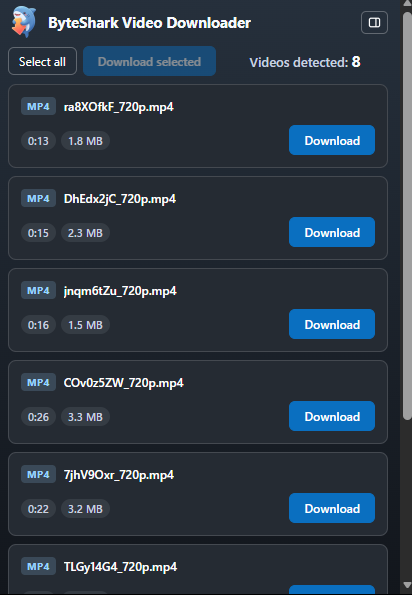
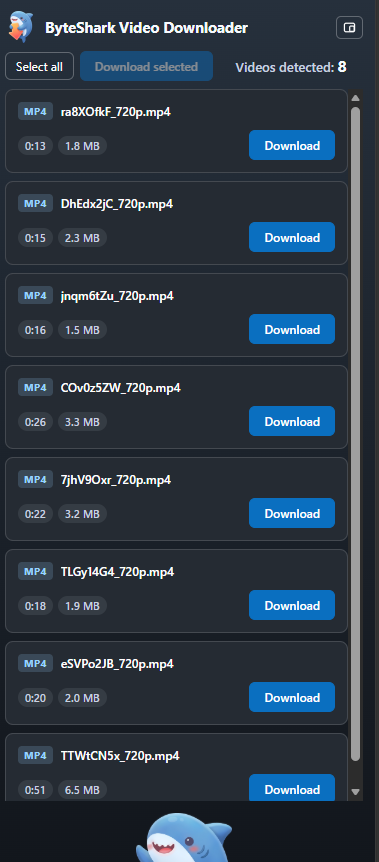

# ByteShark Video Downloader

A Chrome Manifest V3 extension that downloads MP4 files and HLS streams without opening a tab. All
processing happens in a hidden offscreen document, so the page you are watching is never disturbed.

| Popup | Side panel |
| :---: | :---: |
|  |  |

## Install

```
npm install
npm run build
```

Then open `chrome://extensions`, enable **Developer mode**, choose **Load unpacked**, and select
`.output/chrome-mv3`.

Minimum Chrome version is 123. Offscreen documents arrived in 116, but the UI themes itself with
`light-dark()`, which needs 123.

## Use

1. Play the video on the page, so the media request actually happens.
2. Click the extension icon. Detected media is listed as `MP4` or `HLS`.
3. Press **Download**. An HLS master shows a quality dropdown, defaulting to the highest rendition;
   anything estimated above 500 MB asks for confirmation first.
4. The file is saved silently to your downloads folder, named after the tab title.

## What works

- **Direct MP4** — handed to Chrome's download manager. No bytes pass through the extension.
- **HLS** — plain MPEG-TS, fMP4/CMAF (`EXT-X-MAP`), and split audio/video renditions, muxed into a
  single MP4.
- **AES-128 encrypted HLS**, including per-segment IVs and mid-playlist key rotation.
- **Hotlink-protected media** — `Referer`/`Origin` are rewritten per job with `declarativeNetRequest`
  session rules. If the download manager is refused, the file is re-fetched inside the offscreen
  document, where those rules do apply. A host that refuses once is remembered, so later downloads
  from it go straight to the offscreen fetch and leave no failed entry in your download list.
- **Quality dropdown** on every multi-rendition HLS stream, defaulting to the highest quality, and a
  **500 MB size warning** before large jobs start.
- **Size and duration before you commit** — an MP4 shows its exact size (from `Content-Length`) and
  runtime (read from its `moov` box); an HLS stream shows a `~` estimate (bitrate × duration) and the
  playlist's total length. The estimate follows the rendition selected in the dropdown.
  When a site requests both a single-variant master and the rendition it points at, the duplicate row
  is hidden rather than offering the same file twice.
- **Named after the video** — the filename comes from the page's own name for it: `og:title` /
  `video:title` / `twitter:title` / `VideoObject` JSON-LD, then `document.title`, then the page's
  `h1`. An id never becomes a filename — when a page names itself with a UUID you get the heading,
  and if there is nothing human to use at all, `video.mp4`. The chosen name is then forced onto the
  download itself, so a site that answers with `Content-Disposition: filename="431392"` cannot
  override it.
- **Live progress** — every path reports how far the transfer has got: bytes for an MP4, segments and
  bytes for HLS. A direct download is polled from Chrome's download item, since its bytes never pass
  through the extension.
- **Click the toolbar icon to dock the panel** — the UI opens as a vertical panel on the right instead
  of a popup, and keeps following the tab you switch to. The button in the header moves you to the
  other surface immediately and remembers the choice.
- **Download several at once** — click anywhere on the cards you want (or _Select all_) and press
  _Download selected_. A batch uses each card's selected quality and skips the per-download prompts,
  so nothing sits waiting on a picker.
- **Badge count on the toolbar icon** — how many videos are available on the current tab, so you can
  see there is something to download without opening the popup. It clears when you navigate away.
- **Cancel** at any point during a job; DRM rules and staging files are cleaned up within a second,
  and the row stays downloadable — cancelling is never a dead end.
- **Survives the tab closing** — once a job has started it no longer reads the page's detection, so
  closing or navigating away mid-download does not break it.

## What does not work

Detected and reported as `UNSUPPORTED` or `DRM_BLOCKED` rather than attempted:

- **DRM** — Widevine, PlayReady, FairPlay and the `SAMPLE-AES`/`CENC` variants keyed by them. This
  extension does not decrypt them and will not try.
- **`SAMPLE-AES` with an identity key** — not decryptable in this version.
- **Live streams** — a playlist with no `#EXT-X-ENDLIST`.
- **DASH (`.mpd`)** — not supported in v1.
- **Discontinuities** (`EXT-X-DISCONTINUITY`) — no timestamp rewriting, so the result may be
  imperfect for such playlists.

Known limitations:

- `EXT-X-BYTERANGE` on init segments or media segments is not fetched with `Range` requests.
- Filenames come from the tab title with basic sanitising; there are no per-site templates.
- A single stalled segment pauses the whole job rather than being reordered around.

## Permissions

| Permission              | Why                                                                                                                                                  |
| ----------------------- | ---------------------------------------------------------------------------------------------------------------------------------------------------- |
| `downloads`             | Saves the finished file silently. There is no other way to write to the downloads folder.                                                            |
| `webRequest`            | Observes response headers to detect media. It never modifies a request — MV3 does not allow that.                                                    |
| `declarativeNetRequest` | Rewrites `Referer`/`Origin` for a job's own hosts, so hotlink-protected media loads. Session rules only, never dynamic ones.                         |
| `offscreen`             | Provides the hidden document that assembles the file. A service worker has no `URL.createObjectURL`, so the blob URL must live somewhere with a DOM. |
| `storage`               | `storage.session` holds job state across service-worker restarts. No user data leaves the browser.                                                   |
| `scripting`             | Reads the page's `og:title` so the saved file is named after the video instead of a UUID or content id. Runs only when Download is pressed.          |
| `sidePanel`             | Lets the toolbar icon dock the UI as a side panel instead of a popup.                                                                                |
| `<all_urls>`            | Media can be served from any host, and a rejected `host_permissions` request cannot be recovered from at runtime.                                    |

## Development

```
npm run dev        # WXT dev server
npm run compile    # tsc --noEmit
npm run lint       # biome
npm run build      # production build
```

### Reloading after a build

Chrome caches the extension's service worker, so a rebuilt extension can keep running the old code.
Reload it from `chrome://extensions` after `npm run build` — otherwise a stale build looks like a bug.

### Diagnostics

Run `await diagnostics()` in the service worker console (`chrome://extensions` → **service worker**)
to print the tab count, session keys, job states, DNR session rules and the OPFS listing. Between
jobs, `opfsDirs` and `dnrRuleCount` should both be empty.

## License

[PolyForm Noncommercial License 1.0.0](https://polyformproject.org/licenses/noncommercial/1.0.0) —
free to use, modify and share for any noncommercial purpose.
